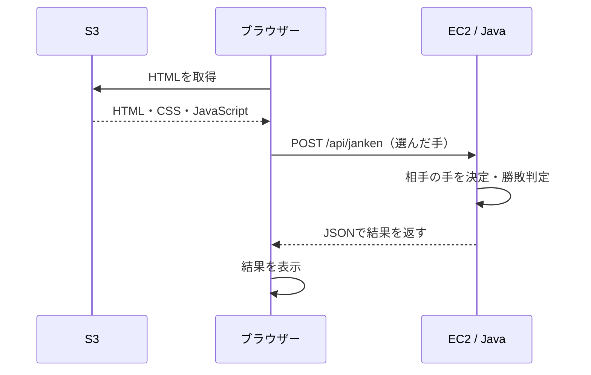

# AWS学習用じゃんけんアプリ：実装指示

## 目的

S3でHTMLを配信し、EC2上のJavaでロジックを実行する、初心者向けの小さなWebアプリを作成してください。題材はじゃんけんとします。画面・通信・バックエンドの役割を理解できる、読みやすく説明しやすい実装を優先してください。

## 必須アーキテクチャ

- フロントエンド：S3に配置するHTML・CSS・素のJavaScript。
- バックエンド：EC2上で動かすJava / Spring BootのREST API。
- ブラウザーがS3からHTMLを取得し、JavaScriptのfetchでEC2のAPIを呼ぶ。
- 相手の手の決定と勝敗判定は必ずJava側で実行する。
- APIはJSONを受け取り、JSONを返す。
- S3からEC2へ直接リクエストする設計にはしない。
- 初期構成ではDB、ログイン、React、Docker、Lambda、API Gateway、ロードバランサーを追加しない。
- EC2からHTMLを配信する構成へ勝手に変更しない。



## 技術方針

- Java 21、Maven、Spring Bootを基本とする。
- Spring BootはJava 21に対応する安定版を実装時に公式情報で確認し、pom.xmlに具体的なバージョンを固定する。
- Maven Wrapperを同梱し、実行可能なJARとしてビルドする。
- フロントエンドはfrontend/index.htmlの1ファイルにCSSとJavaScriptをまとめてよい。
- APIのベースURLはJavaScript冒頭のAPI_BASE_URLで変更できるようにする。
- JavaはController、Service、リクエスト・レスポンスDTO、設定クラスに必要な範囲で分ける。
- 過剰な抽象化や依存ライブラリーを避ける。

## 画面仕様

1. 「グー」「チョキ」「パー」のボタンを表示する。
2. ボタン操作で選んだ手をAPIへ送る。
3. 自分の手、相手の手、勝ち・負け・あいこを日本語で表示する。
4. 通信中はボタンを無効化し、連打による重複送信を防ぐ。
5. 通信失敗やAPIエラーを画面に表示し、再操作できるようにする。
6. レスポンスの表示はtextContentなどを使う。

## API仕様

### POST /api/janken

Content-Type: application/json

リクエスト例：

```json
{"hand":"rock"}
```

handはrock（グー）、scissors（チョキ）、paper（パー）のいずれか。

正常レスポンス例（HTTP 200）：

```json
{"playerHand":"rock","computerHand":"scissors","result":"win"}
```

- resultはプレイヤー視点でwin / lose / draw。
- 相手の手はJava側で3種類からランダムに選ぶ。
- 勝敗判定はランダム生成と分離し、手の組み合わせを指定して検証できるようにする。
- handの欠落・null・未知の値・不正なJSONはHTTP 400を返す。
- エラーはJSON形式に統一し、スタックトレースを利用者へ返さない。

エラーレスポンス例：

```json
{"message":"handにはrock、scissors、paperのいずれかを指定してください。"}
```

### GET /api/health

動作確認用にHTTP 200で以下を返す。

```json
{"status":"ok"}
```

## CORS・通信設定

- ローカル画面とS3画面のオリジンを、環境変数ALLOWED_ORIGINSで切り替えられるようにする。
- オリジンにはスキーム・ホスト・必要なポートを含め、パスや末尾のスラッシュは含めない。
- 許可対象は/api/**とし、GET・POSTおよび必要なOPTIONSプリフライトに対応する。
- Content-Typeヘッダーを許可する。認証Cookieは使わない。
- 本番想定の許可オリジンにワイルドカードを使わない。
- CORSはブラウザーの制約であり、APIの認証やネットワーク制限の代わりにはならない。
- フロントエンドにAWSアクセスキーなどの秘密情報を埋め込まない。

## 学習用AWS構成

最初は、機密情報を扱わない短時間の演習として、S3のHTTP静的ウェブサイトとEC2のHTTP APIを接続する。HTTPS構成とは明確に区別して説明する。

### S3

- frontend/index.htmlを配置し、静的ウェブサイトホスティングのインデックスをindex.htmlにする。
- 公開が必要な演習用ファイルだけを専用バケットに置く。
- 公開する場合は、そのバケットに必要な読み取り権限だけを設定する。アカウント全体の設定を不用意に緩めない。
- 実際に返されたウェブサイトエンドポイントを使い、URLを推測しない。

### EC2

- Amazon Linux 2023を基本とする。
- バックエンドのソースコードはGitHubで管理する。EC2にGitとJavaの開発環境（JDK）を用意し、リポジトリをcloneする。EC2上でMaven Wrapperを使ってビルドし、生成したJARを起動する。継続稼働にはsystemdを使用する。
- 更新時はEC2でgit pullを行い、Maven Wrapperで再ビルドする。ビルド成功後に稼働用JARを更新し、systemdでサービスを再起動する。
- 学習用APIのポートは8080とし、外部アクセス時は必要なインターフェースで待ち受ける。
- セキュリティグループでは8080を演習参加者のグローバルIPなど必要な範囲から許可する。
- APIへの通信元はブラウザーを操作する利用者であり、S3のIPではない。
- SSHを使う場合、22番ポートは管理者のIPに限定する。
- インターネットから接続可能なネットワーク経路とパブリックIPまたはDNSを用意する。
- EC2停止・起動でパブリックIPが変わる場合、API_BASE_URLの更新が必要になることを記載する。
- systemdのサービス定義を用意し、自動起動、再起動、状態確認、ログ確認の手順を記載する。

### HTTPSへ拡張する場合

- HTTPSの画面からHTTPのAPIへfetchするとMixed Contentでブロックされるため、画面だけHTTPSにしない。
- 画面は非公開S3＋CloudFront（OAC）、APIはEC2側のリバースプロキシと証明書などでHTTPS化する案を別途説明する。
- 初回教材にHTTPSの追加構築を混ぜず、発展課題として分ける。

## 作成する成果物

| パス | 内容 |
|---|---|
| frontend/index.html | ボタン、表示、API通信を含む画面 |
| backend/pom.xml | Java / Spring Bootのビルド設定 |
| backend/mvnwなど | Maven Wrapper一式 |
| backend/src/main/java/... | API、判定処理、DTO、CORS、エラー処理 |
| backend/src/main/resources/application.properties | ポート・環境変数など |
| backend/src/test/java/... | 勝敗判定とAPI入力検証のテスト |
| deploy/janken.service | EC2で継続稼働させるsystemdサービス定義 |
| README.md | ローカル実行、GitHubからEC2への初回デプロイ・更新、動作確認、停止・片付け手順 |

## 実装・説明の順序

1. ファイル構成と役割分担を短く説明する。
2. JavaのAPIを実装し、curlで確認する。
3. HTMLを実装し、ローカルのHTTPサーバーからAPIに接続する。file://での確認は基本手順にしない。
4. HTMLをS3に配置して、画面の表示を確認する。
5. ソースコードをGitHubへpushする。EC2にGitとJDKを用意し、リポジトリをcloneしてbackendディレクトリでMaven Wrapperを使いビルドする。生成したJARをsystemdで起動し、ヘルスチェックとじゃんけんAPIを確認する。
6. API_BASE_URLとALLOWED_ORIGINSを設定し、ブラウザーから一連の動作を確認する。
7. READMEに初心者向けの再現手順をまとめる。コマンドを実行する場所がローカルかEC2かを明記する。

## 完了条件

- 3種類の手が送信でき、自分と相手の手および結果が画面に表示される。
- 全9通りの勝敗判定が正しいことをテストする。
- 不正な入力がHTTP 400になることを確認する。
- 許可オリジンのプリフライトと実リクエストが通り、許可していないオリジンにCORS許可ヘッダーを返さないことを確認する。
- API停止時などに画面がエラーを表示し、ボタンを再操作できる。
- READMEにローカル動作確認、AWS設定、GitHubからEC2への初回デプロイと更新、systemdの操作、課金対象の停止・削除方法を記載する。
- 実際に確認したことと、AWSアカウントなどがなく未確認のことを区別して報告する。

## 作業上の注意

- この指示書に従ってコードと手順書を作成することを基本とする。
- AWSリソースの実作成・有料構成への変更・外部公開は、ユーザーからその操作の依頼がある場合に行う。
- 既存リポジトリがある場合は先に構成を確認し、無関係なファイルを変更しない。
- AWSの操作手順や依存関係のバージョンは、実装時点の公式情報を確認する。
- 不明な値はプレースホルダーで示し、実在するURL・認証情報・リソースIDを捏造しない。