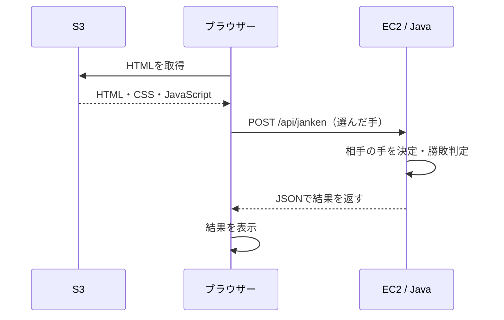

# じゃんけんアプリ（AWS学習用）

S3から配信したHTMLの画面と、EC2上で動くJava（Spring Boot）のAPIをつなぐ、学習用の小さなWebアプリです。
**相手の手を決めるのと勝敗を判定するのは、すべてJava側（EC2）** で行います。



ポイントは次の3つです。

- S3は**ファイルを置いて返すだけ**で、じゃんけんの処理はしません。
- S3がEC2を呼ぶのではなく、**ブラウザーのJavaScriptがEC2を直接呼びます**。したがってAPIへのアクセス元は利用者のグローバルIPであり、S3のIPではありません。
- 画面とAPIはオリジン（スキーム・ホスト・ポートの組み合わせ）が違うため、APIでCORSの許可設定が必要になります。

---

## 1. ファイル構成と役割

| パス | 役割 |
|---|---|
| `frontend/index.html` | 画面。ボタン・表示・API通信（fetch）を1ファイルにまとめている。S3に置くのはこのファイル。 |
| `backend/pom.xml` | Java / Spring Bootのビルド設定。Spring Bootのバージョンを固定している。 |
| `backend/mvnw`, `backend/mvnw.cmd`, `backend/.mvn/` | Maven Wrapper。Mavenを別途インストールせずにビルドできる。 |
| `backend/src/main/java/com/example/janken/JankenApplication.java` | アプリの起動クラス。 |
| `backend/src/main/java/com/example/janken/controller/JankenController.java` | APIの入口。`POST /api/janken` と `GET /api/health`。 |
| `backend/src/main/java/com/example/janken/controller/GlobalExceptionHandler.java` | 例外をJSONのエラーに変換する。スタックトレースは返さない。 |
| `backend/src/main/java/com/example/janken/service/JudgeService.java` | 勝敗判定だけを行う。乱数を使わないのでテストしやすい。 |
| `backend/src/main/java/com/example/janken/service/HandGenerator.java` | 相手の手をランダムに決める。判定と分離してある。 |
| `backend/src/main/java/com/example/janken/service/JankenService.java` | 「入力の変換 → 相手の手 → 判定 → 応答」の流れをまとめる。 |
| `backend/src/main/java/com/example/janken/service/Hand.java`, `Result.java`, `InvalidHandException.java` | 手・勝敗の定義と、不正な入力を表す例外。 |
| `backend/src/main/java/com/example/janken/dto/` | リクエスト・レスポンス・エラーのJSON構造。 |
| `backend/src/main/java/com/example/janken/config/CorsConfig.java` | CORSの許可設定。環境変数`ALLOWED_ORIGINS`で切り替える。 |
| `backend/src/main/resources/application.properties` | ポートや環境変数の既定値。 |
| `backend/src/test/java/...` | 勝敗判定（全9通り）・入力検証・CORSのテスト。 |
| `deploy/janken.service` | EC2でAPIを常駐させるsystemdのサービス定義。 |

### 使用バージョン

| 項目 | バージョン | 備考 |
|---|---|---|
| Java | 21 | Spring Boot 3.5.x は Java 17〜25 に対応（公式のSystem Requirementsで確認） |
| Spring Boot | 3.5.16 | `backend/pom.xml` で固定。2026年10月時点の3.x系最新安定版 |
| Maven | 3.9.16 | Maven Wrapperが自動でダウンロードする |

---

## 2. API仕様

### `POST /api/janken`

リクエスト（`Content-Type: application/json`）

```json
{"hand":"rock"}
```

`hand` は `rock`（グー）、`scissors`（チョキ）、`paper`（パー）のいずれかです。

正常レスポンス（HTTP 200）

```json
{"playerHand":"rock","computerHand":"scissors","result":"win"}
```

`result` はプレイヤー視点で `win` / `lose` / `draw` です。

エラーレスポンス（HTTP 400）

```json
{"message":"handにはrock、scissors、paperのいずれかを指定してください。"}
```

`hand` の欠落・`null`・未知の値はHTTP 400、JSONとして壊れたボディもHTTP 400を返します。

### `GET /api/health`

動作確認用。常にHTTP 200で以下を返します。

```json
{"status":"ok"}
```

---

## 3. ローカルで動かす

> ここのコマンドはすべて**ローカルPC**で実行します。

### 3-1. 前提

- JDK 21（`java -version` で 21 と表示されること）
- Maven は不要（Maven Wrapperが自動で用意します）

JDKが未インストールの場合の例：

```bash
# 【ローカル / macOS + Homebrew】
brew install openjdk@21
export JAVA_HOME=/opt/homebrew/opt/openjdk@21/libexec/openjdk.jdk/Contents/Home
export PATH="$JAVA_HOME/bin:$PATH"
java -version
```

### 3-2. テストを実行する

```bash
# 【ローカル】
cd backend
./mvnw test
```

勝敗判定の全9通り、不正入力の400、CORSの許可・拒否を検証します。

### 3-3. APIを起動する

```bash
# 【ローカル】
cd backend
ALLOWED_ORIGINS=http://localhost:8000 ./mvnw spring-boot:run
```

JARを作ってから起動する場合：

```bash
# 【ローカル】
cd backend
./mvnw clean package
ALLOWED_ORIGINS=http://localhost:8000 java -jar target/janken.jar
```

`ALLOWED_ORIGINS` は**画面を配信するオリジン**を指定します（APIのURLではありません）。

### 3-4. curlでAPIを確認する

別のターミナルを開いて実行します。

```bash
# 【ローカル】ヘルスチェック
curl -i http://localhost:8080/api/health

# 【ローカル】正常なリクエスト
curl -X POST http://localhost:8080/api/janken \
  -H 'Content-Type: application/json' \
  -d '{"hand":"rock"}'

# 【ローカル】不正なリクエスト（400になる）
curl -i -X POST http://localhost:8080/api/janken \
  -H 'Content-Type: application/json' \
  -d '{"hand":"guu"}'

# 【ローカル】許可オリジンのプリフライト（Access-Control-Allow-Originが返る）
curl -i -X OPTIONS http://localhost:8080/api/janken \
  -H 'Origin: http://localhost:8000' \
  -H 'Access-Control-Request-Method: POST' \
  -H 'Access-Control-Request-Headers: Content-Type'

# 【ローカル】許可していないオリジン（403になり、許可ヘッダーは返らない）
curl -i -X OPTIONS http://localhost:8080/api/janken \
  -H 'Origin: http://evil.example.com' \
  -H 'Access-Control-Request-Method: POST'
```

### 3-5. 画面を表示する

`file://` で開くとオリジンが `null` になりCORSで弾かれます。**必ずHTTPサーバー経由**で開いてください。

```bash
# 【ローカル】別のターミナルで実行
cd frontend
python3 -m http.server 8000
```

ブラウザーで <http://localhost:8000> を開き、グー・チョキ・パーのボタンを押します。
自分の手・相手の手・勝敗が日本語で表示されれば成功です。

API側を `Ctrl + C` で止めてからボタンを押すと、画面にエラーが表示され、
そのままボタンを押し直せることも確認できます。

---

## 4. AWSに置く（学習用・HTTP構成）

> この章は、**機密情報を扱わない短時間の演習**を前提にしています。
> 画面もAPIもHTTP（暗号化なし）です。本番で使う構成ではありません。
> HTTPSにする場合は「8. HTTPSへ拡張する場合」を読んでください。

作業の順番は次のとおりです。

1. ソースコードをGitHubにpushする（ローカル）
2. S3に画面を置く（AWSマネジメントコンソール）
3. EC2でAPIを動かす（EC2にSSH）
4. `ALLOWED_ORIGINS` と `API_BASE_URL` をお互いのURLに合わせる
5. ブラウザーで通しで確認する

### 4-1. GitHubにpushする

> 【ローカル】で実行します。
>
> このプロジェクトは <https://github.com/cheryy1974/aws-janken-app> にpush済みです。
> 自分のアカウントで一からやり直す場合は、URLを自分のものに読み替えてください。

```bash
# 【ローカル】プロジェクトのルートで
cd /path/to/jyanken
git init
git add .
git commit -m "じゃんけんアプリの初期実装"
git branch -M main
git remote add origin https://github.com/cheryy1974/aws-janken-app.git
git push -u origin main
```

### 4-2. S3に画面を置く

S3は「HTMLなどのファイルを置いて、ブラウザーに返す」役割だけを担います。

1. S3でこの演習専用のバケットを作る（例: `janken-frontend-<自分の識別子>`）。
2. 「ブロックパブリックアクセス」のうち、**このバケットに対して**公開読み取りを許可する設定だけを外す。アカウント全体の設定は不要に緩めない。
3. バケットのプロパティで **静的ウェブサイトホスティング** を有効にし、インデックスドキュメントを `index.html` にする。
4. バケットポリシーで、このバケットのオブジェクトだけに読み取りを許可する。

```json
{
  "Version": "2012-10-17",
  "Statement": [
    {
      "Sid": "PublicReadForJankenFrontend",
      "Effect": "Allow",
      "Principal": "*",
      "Action": "s3:GetObject",
      "Resource": "arn:aws:s3:::janken-frontend-bca2e226/*"
    }
  ]
}
```

5. `frontend/index.html` をアップロードする。
6. 静的ウェブサイトホスティングの画面に表示される **「バケットウェブサイトエンドポイント」をコピーする**。
   形式は `http://<バケット名>.s3-website-<リージョン>.amazonaws.com` のようになりますが、
   リージョンによって区切り文字が違います。**URLは推測せず、実際に表示された値を使ってください。**
7. そのURLをブラウザーで開き、画面が表示されることを確認する（この時点ではAPIが未設定なのでボタンはエラーになります）。

AWS CLIを使う場合のアップロード例：

```bash
# 【ローカル】
aws s3 cp frontend/index.html s3://<バケット名>/index.html --content-type 'text/html; charset=utf-8'
```

> 画面のJavaScriptにAWSのアクセスキーなどの秘密情報は書きません。S3に置いたファイルは誰でも読める状態になります。

#### この演習で実際に作成したバケット

| 項目 | 値 |
|---|---|
| バケット名 | `janken-frontend-bca2e226` |
| リージョン | `ap-northeast-3`（大阪） |
| ウェブサイトエンドポイント | <http://janken-frontend-bca2e226.s3-website.ap-northeast-3.amazonaws.com> |

**エンドポイントの区切り文字はリージョンによって違います。** 大阪リージョンは
`s3-website` のあとが**ドット**（`s3-website.ap-northeast-3`）で、東京などの古いリージョンは
**ハイフン**（`s3-website-ap-northeast-1`）です。やはりURLは推測せず、コンソールに表示された値を使ってください。

AWS CLIだけで同じ構成を作る手順（【ローカル】で実行）：

```bash
# 1. バケットを作る（バケット名は全世界で一意にする）
BUCKET=janken-frontend-$(openssl rand -hex 4)
echo $BUCKET
aws s3api create-bucket --bucket "$BUCKET" --region ap-northeast-3 \
  --create-bucket-configuration LocationConstraint=ap-northeast-3

# 2. ACLでの公開は引き続きブロックし、バケットポリシーでの公開だけを許可する
aws s3api put-public-access-block --bucket "$BUCKET" \
  --public-access-block-configuration \
  'BlockPublicAcls=true,IgnorePublicAcls=true,BlockPublicPolicy=false,RestrictPublicBuckets=false'

# 3. 静的ウェブサイトホスティングを有効にする
aws s3api put-bucket-website --bucket "$BUCKET" \
  --website-configuration '{"IndexDocument":{"Suffix":"index.html"}}'

# 4. このバケットのオブジェクト読み取りだけを許可するポリシーを当てる
cat > /tmp/bucket-policy.json <<JSON
{
  "Version": "2012-10-17",
  "Statement": [
    {
      "Sid": "PublicReadForJankenFrontend",
      "Effect": "Allow",
      "Principal": "*",
      "Action": "s3:GetObject",
      "Resource": "arn:aws:s3:::$BUCKET/*"
    }
  ]
}
JSON
aws s3api put-bucket-policy --bucket "$BUCKET" --policy file:///tmp/bucket-policy.json

# 5. 画面をアップロードする
aws s3 cp frontend/index.html "s3://$BUCKET/index.html" \
  --content-type 'text/html; charset=utf-8'

# 6. ブラウザーで開いて確認する
echo "http://$BUCKET.s3-website.ap-northeast-3.amazonaws.com/"
```

### 4-3. EC2でAPIを動かす

#### (1) インスタンスとネットワーク

- AMI: **Amazon Linux 2023**
- インスタンスタイプ: 学習用なら小さいもの（例: `t3.micro`）で十分
- **パブリックIPを有効**にし、インターネットゲートウェイ経由で外部から接続できるサブネットに置く
- セキュリティグループ（インバウンド）
  - TCP **8080** を、**演習参加者のグローバルIP**（例: `203.0.113.10/32`）から許可
  - SSHを使う場合、TCP **22** を**管理者のグローバルIPだけ**に限定
  - S3のIPを許可する必要はありません。APIを呼ぶのは利用者のブラウザーです。

#### この演習で実際に作成したリソース

| 項目 | 値 |
|---|---|
| インスタンスID | `i-02fbeba48ad429d20` |
| AMI | `ami-0fe44ab3b4e49ac93`（`al2023-ami-2023.12.20261012.0-kernel-6.1-x86_64`） |
| インスタンスタイプ | `t3.micro`（EBS 8GB gp3、終了時に削除） |
| アベイラビリティーゾーン | `ap-northeast-3a`（デフォルトVPCのサブネット `subnet-0e06658dd856266a0`） |
| パブリックIP | `56.155.27.99`（**停止・起動で変わります**） |
| セキュリティグループ | `sg-0b626584c5b83c5ee`（`janken-api-sg`）: 8080と22を管理者のグローバルIP `/32` のみ許可（実際の値は公開リポジトリーに書かず、AWSコンソールで確認してください） |
| キーペア | `janken-key`（ed25519）。秘密鍵は `~/.ssh/janken-key.pem` に権限400で保存 |

AMI IDはリージョンごとに違い、更新もされます。推測せず、次のように**実際に問い合わせた値**を使ってください。

```bash
# 【ローカル】Amazon Linux 2023 の最新AMIを調べる
aws ec2 describe-images --region ap-northeast-3 --owners amazon \
  --filters 'Name=name,Values=al2023-ami-2023.*-kernel-6.1-x86_64' 'Name=state,Values=available' \
  --query 'reverse(sort_by(Images,&CreationDate))[0].{ImageId:ImageId,Name:Name}' --output json
```

SSHでの接続例：

```bash
# 【ローカル】
ssh -i ~/.ssh/janken-key.pem ec2-user@56.155.27.99
```

#### (2) GitとJDKを入れて、リポジトリーをcloneする

> ここからは**EC2にSSHでログインして**実行します。

```bash
# 【EC2】パッケージを更新し、GitとJDK 21を入れる
sudo dnf update -y
sudo dnf install -y git java-21-amazon-corretto-devel
java -version
javac -version
```

```bash
# 【EC2】リポジトリーをcloneする
cd ~
git clone https://github.com/cheryy1974/aws-janken-app.git
cd aws-janken-app/backend
```

#### (3) Maven Wrapperでビルドする

```bash
# 【EC2】
./mvnw clean package
ls -l target/janken.jar
```

初回は Maven と依存ライブラリーのダウンロードに数分かかります。

#### (4) JARを配置して、systemdで常駐させる

```bash
# 【EC2】実行用ユーザーと配置先を用意する
sudo useradd --system --create-home janken
sudo mkdir -p /opt/janken

# 【EC2】ビルドしたJARを稼働用の場所にコピーする
sudo cp target/janken.jar /opt/janken/janken.jar
sudo chown -R janken:janken /opt/janken
```

```bash
# 【EC2】サービス定義を配置する
sudo cp ../deploy/janken.service /etc/systemd/system/janken.service

# 【EC2】ALLOWED_ORIGINS を、4-2でコピーしたS3のウェブサイトエンドポイントに書き換える
sudo vi /etc/systemd/system/janken.service
```

`janken.service` には、この演習で作成したバケットのエンドポイントを設定済みです。
別のバケットを使う場合は次の行を書き換えます。**末尾の `/` やパスは付けません。**

```
Environment=ALLOWED_ORIGINS=http://janken-frontend-bca2e226.s3-website.ap-northeast-3.amazonaws.com
```

ローカルの画面からも試したい場合はカンマ区切りで並べます。

```
Environment=ALLOWED_ORIGINS=http://janken-frontend-bca2e226.s3-website.ap-northeast-3.amazonaws.com,http://localhost:8000
```

```bash
# 【EC2】サービスを有効化して起動する
sudo systemctl daemon-reload
sudo systemctl enable --now janken
sudo systemctl status janken
```

#### (5) EC2上で動作確認する

```bash
# 【EC2】
curl -i http://localhost:8080/api/health
curl -X POST http://localhost:8080/api/janken \
  -H 'Content-Type: application/json' \
  -d '{"hand":"rock"}'
```

```bash
# 【ローカル】外部からも届くか確認する（<EC2のパブリックIP>は実際の値に置き換え）
curl -i http://<EC2のパブリックIP>:8080/api/health
```

外から届かない場合は、セキュリティグループの8080、パブリックIPの有無、サブネットのルートテーブルを確認します。

### 4-4. 画面とAPIをつなぐ

1. `frontend/index.html` のJavaScript冒頭を、EC2のアドレスに書き換えます。

```javascript
const API_BASE_URL = "http://<EC2のパブリックIPまたはDNS>:8080";
```

2. 書き換えた `index.html` をS3に再アップロードします。
3. S3のウェブサイトエンドポイントをブラウザーで開き、ボタンを押します。

### 4-5. 通しでの確認ポイント

- 3種類の手すべてでAPIに送信でき、自分の手・相手の手・勝敗が表示される
- 通信中はボタンが押せない
- EC2で `sudo systemctl stop janken` してからボタンを押すとエラーが表示され、
  起動し直す（`sudo systemctl start janken`）と再び遊べる

> **EC2を停止・起動するとパブリックIPが変わります。**
> その場合は `API_BASE_URL` を新しいIPに書き換えてS3へ再アップロードする必要があります。
> IPを固定したい場合はElastic IPを使いますが、未使用のElastic IPには課金が発生します。

---

## 5. コードを更新したとき（2回目以降のデプロイ）

```bash
# 【ローカル】変更をGitHubへ送る
git add .
git commit -m "変更内容"
git push
```

```bash
# 【EC2】最新を取得して再ビルドする
cd ~/aws-janken-app
git pull
cd backend
./mvnw clean package

# 【EC2】ビルドが成功したことを確認してから、稼働用JARを差し替えてサービスを再起動する
ls -l target/janken.jar
sudo systemctl stop janken
sudo cp target/janken.jar /opt/janken/janken.jar
sudo chown janken:janken /opt/janken/janken.jar
sudo systemctl start janken
sudo systemctl status janken
curl -i http://localhost:8080/api/health
```

画面（`frontend/index.html`）だけを変えた場合は、S3へ再アップロードするだけで反映されます。
ブラウザーのキャッシュが残る場合は、スーパーリロード（再読み込み）を試してください。

---

## 6. systemdの操作

> すべて【EC2】で実行します。

| 目的 | コマンド |
|---|---|
| 状態を見る | `sudo systemctl status janken` |
| 起動する | `sudo systemctl start janken` |
| 停止する | `sudo systemctl stop janken` |
| 再起動する | `sudo systemctl restart janken` |
| OS起動時の自動起動を有効にする | `sudo systemctl enable janken` |
| 自動起動を無効にする | `sudo systemctl disable janken` |
| ログを新しい順に見る | `sudo journalctl -u janken -n 100 --no-pager` |
| ログをリアルタイムで追う | `sudo journalctl -u janken -f` |
| サービス定義を書き換えた後 | `sudo systemctl daemon-reload` してから `restart` |

起動直後のログに `CORSで許可するオリジン: [...]` が出るので、`ALLOWED_ORIGINS` が意図どおり読み込まれているかを確認できます。

---

## 7. うまく動かないときの確認

| 症状 | 確認すること |
|---|---|
| 画面に「APIに接続できませんでした」と出る | `API_BASE_URL` のIP・ポート、EC2でサービスが起動しているか、セキュリティグループの8080 |
| ブラウザーのコンソールに CORS のエラーが出る | `ALLOWED_ORIGINS` が画面のオリジンと**完全一致**しているか（スキーム・ホスト・ポート。末尾の `/` やパスは含めない）。変更後は `sudo systemctl restart janken` |
| `Mixed Content` でブロックされる | 画面がHTTPSでAPIがHTTPになっている。「8. HTTPSへ拡張する場合」を参照 |
| EC2停止・起動後につながらない | パブリックIPが変わっている。`API_BASE_URL` を更新してS3へ再アップロード |
| HTTP 415 が返る | リクエストに `Content-Type: application/json` が付いていない |
| `./mvnw` が `Permission denied` | `chmod +x mvnw` |
| ビルドが `release version 21 not supported` で失敗 | JDK 21が入っていない。`java -version` と `javac -version` を確認 |

CORSはブラウザーが行う制限であり、**APIの認証やネットワーク制限の代わりにはなりません。**
curlなど、ブラウザー以外からのアクセスはCORS設定では防げません。アクセス元の制限はセキュリティグループなどで行います。

---

## 8. HTTPSへ拡張する場合（発展課題）

この教材はHTTP前提です。HTTPSにするときは、**画面だけをHTTPSにしてはいけません。**
HTTPSのページからHTTPのAPIへfetchすると、ブラウザーがMixed Contentとしてブロックします。

画面とAPIの両方をHTTPSにする構成例です。

- **画面**: S3バケットを非公開にし、CloudFront（OAC: Origin Access Control）経由で配信する。CloudFrontの証明書でHTTPSになる。
- **API**: EC2にリバースプロキシ（NginxやCaddyなど）を置き、独自ドメインの証明書でHTTPS化する。あるいはALB + ACMの証明書でHTTPSを終端する。
- どちらの場合も、`ALLOWED_ORIGINS` を `https://...` のオリジンに書き換える。

独自ドメインの取得、DNS設定、証明書の管理が増えるため、HTTP構成が通しで動くことを確認してから別課題として進めてください。

---

## 9. 片付け（課金を止める）

学習が終わったら、課金対象を必ず止めるか削除します。

| 対象 | 操作 |
|---|---|
| EC2インスタンス | 一時的に止めるなら「停止」。使わないなら「終了（Terminate）」。停止中でもEBSボリュームには課金が続きます。 |
| EBSボリューム | インスタンスを終了しても残る設定の場合は、ボリュームを削除する |
| Elastic IP（使った場合） | インスタンスから関連付けを解除し、**解放（Release）**する。未使用のまま保持すると課金されます |
| S3バケット | `index.html` を削除し、バケットも削除する |
| CloudFront（8章を試した場合） | ディストリビューションを無効化してから削除する |

この演習で作ったリソースを消すコマンドです（【ローカル】で実行）。

```bash
# EC2インスタンスを終了する（EBSも一緒に削除される設定にしてあります）
aws ec2 terminate-instances --region ap-northeast-3 --instance-ids i-02fbeba48ad429d20
aws ec2 wait instance-terminated --region ap-northeast-3 --instance-ids i-02fbeba48ad429d20

# セキュリティグループとキーペアを消す（インスタンス終了後でないと消せません）
aws ec2 delete-security-group --region ap-northeast-3 --group-id sg-0b626584c5b83c5ee
aws ec2 delete-key-pair --region ap-northeast-3 --key-name janken-key
rm -f ~/.ssh/janken-key.pem

# S3の中身とバケットを消す
aws s3 rm s3://janken-frontend-bca2e226/index.html
aws s3 rb s3://janken-frontend-bca2e226
```

一時的に止めるだけなら、インスタンスの停止でも課金（インスタンス時間）は止まります。
ただし**停止・起動するとパブリックIPが変わる**ので、`API_BASE_URL` の更新が必要です。

```bash
# 【ローカル】停止と起動
aws ec2 stop-instances --region ap-northeast-3 --instance-ids i-02fbeba48ad429d20
aws ec2 start-instances --region ap-northeast-3 --instance-ids i-02fbeba48ad429d20

# 起動後の新しいパブリックIPを確認する
aws ec2 describe-instances --region ap-northeast-3 --instance-ids i-02fbeba48ad429d20 \
  --query 'Reservations[0].Instances[0].PublicIpAddress' --output text
```

APIだけ止めたい場合は【EC2】で `sudo systemctl stop janken` と `sudo systemctl disable janken` を実行します（EC2の課金は止まりません）。

---

## 10. 確認済みのことと未確認のこと

### ローカルで実際に確認したこと

- `./mvnw test` が成功（テスト39件、失敗0件）
  - 勝敗判定の全9通り
  - `hand` の欠落・`null`・空文字・未知の値・大文字・数値 → HTTP 400
  - 壊れたJSON・空ボディ → HTTP 400
  - エラー応答にスタックトレースやクラス名が含まれないこと
  - 許可オリジンのプリフライトと実リクエストに許可ヘッダーが返り、許可していないオリジンには返らないこと
- `./mvnw clean package` で `target/janken.jar` が生成される
- `java -jar target/janken.jar` で起動し、curlで以下を確認
  - `GET /api/health` → `{"status":"ok"}`
  - `POST /api/janken` → `{"playerHand":...,"computerHand":...,"result":...}`（相手の手が毎回変わる）
  - 不正入力 → HTTP 400 とJSONのメッセージ
  - 許可オリジンのプリフライト → `Access-Control-Allow-Origin` が返る
  - 許可していないオリジン → HTTP 403 で許可ヘッダーなし
- `python3 -m http.server 8000` で `frontend/index.html` がHTTP 200で配信される

### AWS上で実際に確認したこと

- バケット `janken-frontend-bca2e226` を `ap-northeast-3` に作成
- ブロックパブリックアクセスを、ACLはブロックしたままバケットポリシーでの公開のみ許可する設定に変更
- 静的ウェブサイトホスティングを有効化（インデックスドキュメント `index.html`）
- バケットポリシーで、このバケットのオブジェクト読み取りだけを許可
- `index.html` をアップロード（`Content-Type: text/html; charset=utf-8`）
- ウェブサイトエンドポイントがHTTP 200でページを返すことをcurlで確認
  （`s3-website.ap-northeast-3` のドット形式が正しく、ハイフン形式は名前解決できないことも確認済み）

#### EC2

- キーペア `janken-key` とセキュリティグループ `sg-0b626584c5b83c5ee`（8080・22を管理者IPの `/32` のみ許可）を作成
- Amazon Linux 2023 / t3.micro のインスタンス `i-02fbeba48ad429d20` を起動し、SSHで接続
- `dnf` で Git 2.50.1 と Amazon Corretto 21（`java-21-amazon-corretto-devel`）をインストール
- GitHubから `git clone` し、EC2上で `./mvnw clean package` を実行 → **テスト39件が成功**してJARを生成
- `/opt/janken/janken.jar` を配置し、`deploy/janken.service` を `/etc/systemd/system/` に登録
- `systemctl enable --now janken` で起動、`is-enabled`=enabled / `is-active`=active を確認
- 起動ログに `CORSで許可するオリジン: [http://janken-frontend-bca2e226...]` が出ることを確認
- EC2上の `curl` とインターネット越しの `curl` の両方で `/api/health` と `/api/janken` が応答

#### 画面とAPIの接続

- `frontend/index.html` の `API_BASE_URL` を `http://56.155.27.99:8080` に変更してS3へ再アップロード
- S3のオリジンからのプリフライト（OPTIONS）→ 200 と `Access-Control-Allow-Origin` が返る
- S3のオリジンからの実リクエスト（POST）→ 200 と許可ヘッダー、じゃんけんの結果が返る
- 許可していないオリジン → 403、許可ヘッダーなし
- インターネット越しの不正入力 → 400 とJSONのメッセージ

### 未確認のこと

- **ブラウザーでボタンを押しての動作**（クリック操作が必要なため、コマンドからは未確認です）。
  通信中のボタン無効化、API停止時のエラー表示と再操作は、S3のページを開いて実際に押して確認してください。
- HTTPS構成（8章）は未実施です。

一般的な手順説明に出てくる `<バケット名>`・`<リージョン>`・`<EC2のパブリックIP>` はプレースホルダーです。
一方、「この演習で実際に作成した」と書かれた表の値（バケット名、ウェブサイトエンドポイント、
インスタンスID、AMI ID、セキュリティグループID、パブリックIP）と
GitHubのリポジトリーURL（`https://github.com/cheryy1974/aws-janken-app`）は実在する値です。

**EC2を停止・起動するとパブリックIPが変わります。** その場合は
`frontend/index.html` の `API_BASE_URL` を新しいIPに書き換えてS3へ再アップロードしてください。
セキュリティグループの許可元IPも、接続元のグローバルIPが変わったら更新が必要です。

```bash
# 【ローカル】いまのグローバルIPを調べて、許可元を入れ替える
MYIP=$(curl -sS https://checkip.amazonaws.com)
aws ec2 authorize-security-group-ingress --region ap-northeast-3 \
  --group-id sg-0b626584c5b83c5ee \
  --ip-permissions "IpProtocol=tcp,FromPort=8080,ToPort=8080,IpRanges=[{CidrIp=${MYIP}/32}]"
# 古いルールは describe-security-groups で確認し、revoke-security-group-ingress で削除する
```

自分のグローバルIPは個人を特定しうる情報なので、公開リポジトリーには書かないでください。
